<div align="center">


# Lyricsbar

**Lyrics for the song you're playing, in sync on your Touch Bar.**
<br>
For Spotify and Apple Music on the MacBook Pro.

[](https://github.com/kintarous/lyricsbar/releases/latest)
[](https://github.com/kintarous/lyricsbar/releases)
[](LICENSE)
<br>
[](#requirements)
[](#requirements)
[](#requirements)
[](Sources/main.swift)
<br>
[](#features)
[](#features)

<br>

<a href="https://github.com/kintarous/lyricsbar/releases/latest">
  
</a>

<br><br>


<sub><i>Illustration. The lyrics shown are only an example.</i></sub>

<br><br>

🇬🇧 English · [🇮🇩 Bahasa Indonesia](README.md)

</div>

<br>

## Features

|  |  |
|---|---|
| 🎤 **Synced lyrics** | Lines change right on time, with a Spotify-style slide-up animation, a fade, or no animation |
| 🎛️ **Mini Control Strip** | Brightness, volume, mute, ⏮ ⏯ ⏭, right on the Touch Bar |
| 🫧 **Liquid Glass sliders** | A glass capsule knob that grows, turns clear like a lens, and stretches as you drag. Its color follows your system accent color |
| 😀 **Emoji** | One tap brings up the built-in macOS emoji picker and word suggestions |
| ↔️ **Alignment** | Left, center, or right, on the Touch Bar and in the menu bar |
| ⏱️ **Per-song offset** | Lyrics too early or too late? Shift them by ±0.5 s, saved per song |
| 🎧 **Spotify & Apple Music** | Whichever player is playing is used automatically |
| 🐠 **Idle wallpaper** | When nothing is playing and the Mac has been idle for a while, the Touch Bar shows an animation: fish, a train, rain, a city at night, aurora, a cat, a dino, and more (16 themes), including your own text (a name or initials) in black-and-white dot-matrix letters, and today's weather where you are, in black and white and playable: slide a finger to open an umbrella in the rain, push clouds, wipe away fog, or move the sun. Tap to get the standard buttons back |
| 🌐 **English & Indonesian** | Indonesian when your macOS language or region is Indonesia, English otherwise. You can also pick one in the ♪ menu |
| 💤 **Stays out of the way** | Returns to the standard Touch Bar when music is paused, and "sleeps" when the player is closed |
| 🔒 **Private** | No account, no API key, no analytics |

<div align="center">
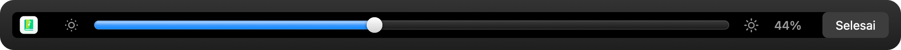
<br>
<sub><i>Tap ☀︎ or 🔊: a full-width Liquid Glass slider that goes back to the lyrics on its own after 4 seconds.</i></sub>
</div>

## Idle wallpaper

When nothing is playing and your Mac has been idle for a while, the Touch Bar shows the animation you picked. **Tap** to get the standard buttons back. Choose a theme and how long to wait in ♪ › **Idle wallpaper**; picking a theme shows it on the Touch Bar right away.

<div align="center">


<sub><i>Your own text: your name or initials in black-and-white dot-matrix letters</i></sub>

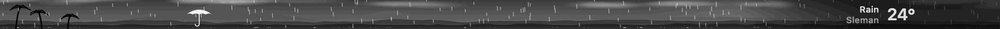
<sub><i>Today's weather where you are. Slide a finger: an umbrella in the rain, clouds you can push, fog you can wipe away, a sun you can move</i></sub>


<sub><i>Dino runner: runs across the bar and jumps the cactus right in the middle</i></sub>

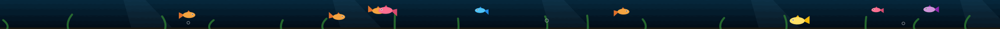
<sub><i>Swimming fish</i></sub>

</div>

<details>
<summary><b>See all 16 themes</b></summary>
<br>

**Your own text**<br>


**Today's weather**<br>


**Swimming fish**<br>
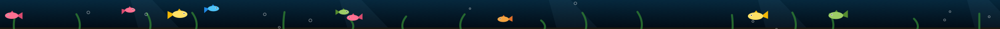

**Passing train**<br>
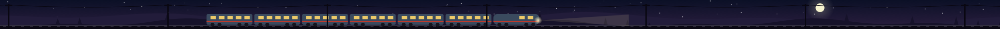

**Rain and lightning**<br>
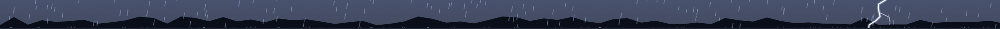

**Clouds and birds**<br>


**City at night**<br>
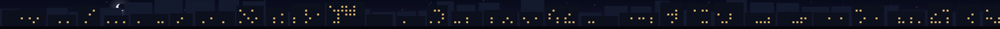

**Flowing particles**<br>


**Aurora**<br>
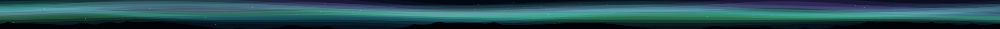

**Fireflies**<br>
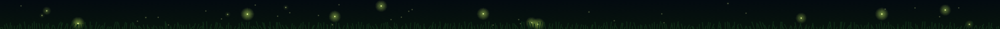

**Matrix rain**<br>
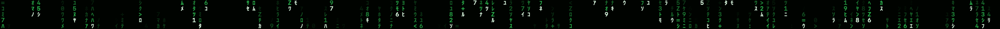

**Game of Life**<br>
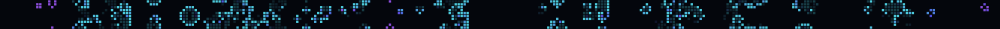

**Wandering cat**<br>
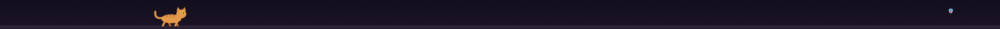

**Marching ants**<br>


**Snake (autoplay)**<br>


**Dino runner (autoplay)**<br>
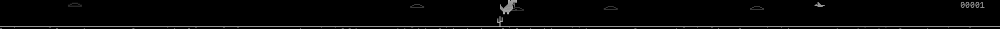

</details>

<sub><i>Rendered straight from the app with <code>--render-wallpaper</code>. The weather data is an example.</i></sub>

## Requirements

- 💻 A MacBook Pro **with a Touch Bar** (2016–2022, Intel or Apple Silicon)
- 🍎 **macOS 13 Ventura** or later
- 🎵 The **Spotify** or **Music** (Apple Music) desktop app

## Installation

1. **Download** `Lyricsbar-<version>.dmg` from the [Releases](https://github.com/kintarous/lyricsbar/releases/latest) page.
2. **Open** the DMG, then **drag Lyricsbar** onto the **Applications** icon.
3. **Launch** Lyricsbar, allow access to Spotify/Music, and play a song. 🎶

> [!IMPORTANT]
> **The first time you open it, macOS will block Lyricsbar** ("Apple could not verify…"). This is normal for a free app that isn't signed with an Apple Developer certificate. To open it:
>
> 1. Open Lyricsbar once, then close the warning.
> 2. Go to **System Settings › Privacy & Security** and scroll to **Security**.
> 3. Click **Open Anyway** next to the message about Lyricsbar, enter your Mac password, then click **Open Anyway** again.
>
> You only need to do this once. After that, Lyricsbar opens like any other app.

<details>
<summary>Alternative: using Terminal</summary>

```bash
xattr -dr com.apple.quarantine /Applications/Lyricsbar.app
```
</details>

### Updating to a new version

1. Quit Lyricsbar from the **♪ › Quit** menu.
2. Download the latest DMG, drag Lyricsbar to **Applications**, and choose **Replace**.
3. Open Lyricsbar again. macOS may ask for **Open Anyway** and Spotify/Music access once more for the new version.

Your settings, per-song offsets, and saved lyrics are kept.

## How to use

Every setting lives in the **♪** icon in the menu bar.

<details>
<summary><b>The ♪ menu</b></summary>

| Menu | What it does |
|---|---|
| Offset −0.5 / +0.5 / Reset | Shifts the lyrics timing for this song. **+** = earlier, **−** = later |
| Search lyrics again | Looks up the lyrics for this song again |
| Open your lyrics folder… | Where you put your own `.lrc` files |
| Lyrics animation | Slide up, fade, or no animation |
| Lyrics alignment | Left, center, or right |
| Idle wallpaper | Pick a theme (it previews right away), your own text, the weather location, and how long to wait |
| Language | Same as system, Bahasa Indonesia, or English |
| Also show lyrics in menu bar | Shows the current lyric line in the menu bar |
| Open at login | Starts Lyricsbar automatically when you log in |
</details>

<details>
<summary><b>Touch Bar buttons</b></summary>

| Button | What it does |
|---|---|
| Player logo | Opens Spotify/Music |
| 😀 | Shows the Touch Bar of the app you're using (emoji picker and word suggestions). The lyrics come back on their own after 8 seconds without typing |
| ☀︎ / 🔊 | Brightness / volume slider. Goes back to the lyrics after 4 seconds, or tap **Done** |
| 🔇 | Mute |
| ⏮ ⏯ ⏭ | Previous track, play/pause, next track |
</details>

## Where do the lyrics come from?

Lyricsbar looks for synced lyrics in this order:

1. 📁 **Local files**: `~/Music/Lyricsbar/` (and `~/Music/LyricsX/` if you used LyricsX before), named `Title - Artist.lrc`
2. 🌐 [**LRCLIB**](https://lrclib.net): a free, open lyrics database
3. 🌏 **NetEase Cloud Music**: a fallback with many Asian songs

Official Spotify and Apple Music lyrics are **not** used, because there's no official way to access them.

> [!TIP]
> Can't find your song? Make your own `.lrc` file (for example with [LRCGET](https://github.com/tranxuanthang/lrcget)), save it via ♪ › **Open your lyrics folder…**, then click **Search lyrics again**. Even better, upload it to LRCLIB so it helps others too.

## Privacy

- No servers, analytics, or data collection.
- To find lyrics, the song's **title, artist, album, and duration** are sent to LRCLIB and NetEase. Lyrics that are found are saved in `~/Library/Caches/local.touchbarlyrics/`.
- If you use the **Today's weather** wallpaper, your MacBook's location (rounded to about 1 km) is sent to [Open-Meteo](https://open-meteo.com) to get the weather, and the city name is looked up through Apple. You can also set a city yourself in the ♪ menu without granting Location access.
- The permission Lyricsbar asks for is **Automation**, to read the song and playback position from Spotify/Music. Brightness and volume work without extra permissions. **Location** is only requested when you choose the weather wallpaper with automatic location.

## Limitations

- The Touch Bar display uses private Apple APIs (like LyricsX, Pock, and MTMR do). A future macOS update could break it.
- While lyrics are shown, the standard Control Strip is hidden and replaced by Lyricsbar's mini version.
- Volume can't be changed when sound goes out over HDMI. This is a macOS limitation; the button is shown grayed out.
- Lyrics accuracy depends on the source. Use the offset to fine-tune.

## Building from source

Requires the Xcode Command Line Tools (`xcode-select --install`).

```bash
git clone https://github.com/kintarous/lyricsbar.git
cd lyricsbar
./build.sh install
```

<details>
<summary>Other commands</summary>

| Command | Result |
|---|---|
| `./build.sh` | `build/Lyricsbar.app` (universal) |
| `./build.sh install` | Builds and installs to `/Applications` |
| `./build.sh release` | `dist/Lyricsbar-<version>.dmg` and `.zip` for GitHub Releases |

The version comes from `CFBundleShortVersionString` in `Info.plist`.

To test the lyrics lookup without playing a song:

```bash
build/Lyricsbar.app/Contents/MacOS/Lyricsbar --lookup "Title" "Artist" 240
```

To render a wallpaper to a PNG without the Touch Bar (start second, frame count, seconds between frames):

```bash
build/Lyricsbar.app/Contents/MacOS/Lyricsbar --render-wallpaper dino 4 10 0.06 dino.png
```
</details>

## Version history

| Version | Changes |
|---|---|
| [**1.2**](https://github.com/kintarous/lyricsbar/releases/tag/v1.2) | Idle Touch Bar wallpaper with 16 themes, including your own text in black-and-white dot-matrix letters and today's weather that you can play with using your finger. English language (follows your macOS language or region, or pick it in the ♪ menu) and an English README |
| [**1.1**](https://github.com/kintarous/lyricsbar/releases/tag/v1.1) | Liquid Glass brightness and volume sliders (glass capsule knob, thin track in the system accent color), with touch animations: springy growth, lens-like clarity, and stretching on fast drags |
| [**1.0**](https://github.com/kintarous/lyricsbar/releases/tag/v1.0) | First release: synced lyrics for Spotify and Apple Music, mini Control Strip, emoji button, lyrics animation and alignment, per-song offset, sleep mode |

## Credits

- Lyrics: [LRCLIB](https://lrclib.net) and NetEase Cloud Music
- Weather: [Open-Meteo](https://open-meteo.com)
- App icon: <a href="https://www.flaticon.com/free-icon/music-book_4675527" title="music book icons">Music book icons created by Magnific - Flaticon</a> (Flaticon License, free with attribution)

Lyricsbar isn't affiliated with Spotify or Apple. Spotify, Apple Music, and Touch Bar are trademarks of their respective owners.

## License

[MIT](LICENSE) © 2026 kintarous

The MIT License covers the Lyricsbar code. The app icon has its own license from its creator (see [Credits](#credits)).

<div align="center">
<br>
<sub>Made with ♪ for the Touch Bar that too often gets ignored.</sub>
</div>
