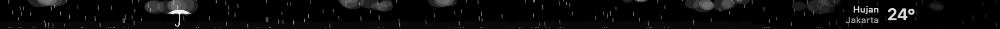

<div align="center">


# Lyricsbar

**Lirik lagu yang sedang kamu putar, tampil sinkron di Touch Bar.**
<br>
Untuk Spotify dan Apple Music di MacBook Pro.

[](https://github.com/kintarous/lyricsbar/releases/latest)
[](https://github.com/kintarous/lyricsbar/releases)
[](LICENSE)
<br>
[](#kebutuhan)
[](#kebutuhan)
[](#kebutuhan)
[](Sources/main.swift)
<br>
[](#fitur)
[](#fitur)

<br>

<a href="https://github.com/kintarous/lyricsbar/releases/latest">
  
</a>

<br><br>


<sub><i>Ilustrasi tampilan. Teks liriknya hanya contoh.</i></sub>

<br><br>

[🇬🇧 English](README.en.md) · 🇮🇩 Bahasa Indonesia

</div>

<br>

## Fitur

|  |  |
|---|---|
| 🎤 **Lirik sinkron** | Berganti baris tepat waktu, dengan animasi geser ke atas ala Spotify, pudar, atau tanpa animasi |
| 🎛️ **Control Strip mini** | Kecerahan, volume, mute, ⏮ ⏯ ⏭, langsung dari Touch Bar |
| 🫧 **Slider Liquid Glass** | Knob kapsul kaca yang membesar, bening seperti lensa, dan melar saat digeser. Warnanya mengikuti warna aksen sistem |
| 😀 **Emoji** | Satu ketukan untuk memunculkan pemilih emoji dan saran kata bawaan macOS |
| ↔️ **Perataan** | Rata kiri, tengah, atau kanan, di Touch Bar maupun menu bar |
| ⏱️ **Offset per lagu** | Lirik terlalu cepat atau lambat? Geser ±0,5 detik, tersimpan per lagu |
| 🎧 **Spotify & Apple Music** | Pemutar yang sedang memutar lagu dipakai otomatis |
| 🐠 **Wallpaper saat idle** | Saat tidak ada lagu dan Mac lama tidak disentuh, Touch Bar menampilkan animasi: ikan, kereta, hujan, kota malam, aurora, kucing, dino, dan lainnya (16 tema), termasuk teks buatanmu sendiri (nama atau inisial) dalam huruf dot-matrix hitam putih, dan cuaca hari ini di lokasimu dalam hitam putih yang bisa dimainkan: geser jari untuk memunculkan payung saat hujan, mendorong awan, menyapu kabut, atau memindah matahari. Ketuk untuk kembali ke tombol bawaan |
| 🌐 **Indonesia & Inggris** | Bahasa Indonesia kalau bahasa atau wilayah macOS-mu Indonesia, selain itu Inggris. Bisa juga dipilih di menu ♪ |
| 💤 **Tahu diri** | Kembali ke Touch Bar bawaan saat musik dijeda, dan "tidur" saat pemutar ditutup |
| 🔒 **Privat** | Tanpa akun, tanpa API key, tanpa analytics |

<div align="center">

<br>
<sub><i>Ketuk ☀︎ atau 🔊: slider selebar Touch Bar bergaya Liquid Glass, kembali ke lirik sendiri setelah 4 detik.</i></sub>
</div>

## Wallpaper saat idle

Saat tidak ada lagu yang diputar dan Mac lama tidak dipakai, Touch Bar menampilkan animasi pilihanmu. Wallpaper tetap tampil walau kamu mengetik atau mengklik; **ketuk** Touch Bar untuk kembali ke tombol bawaan (atau pilih menu ♪ › Wallpaper saat idle › Tutup saat › *Disentuh, mengetik, atau klik*). Pilih tema dan lama menunggunya di menu ♪ › **Wallpaper saat idle**; memilih tema langsung menampilkannya di Touch Bar.

**Aman untuk layar OLED Touch Bar:** seluruh gambar bergeser beberapa piksel secara berkala, kecerahan maksimumnya dibatasi, elemen yang diam (suhu, matahari, bulan, garis tanah) dibuat redup dan bergeser pelan, dan setelah 1 jam tampil tanpa disentuh, animasinya meredup dan melambat sampai disentuh lagi.

<div align="center">


<sub><i>Teks sendiri: nama atau inisialmu dalam huruf dot-matrix hitam putih</i></sub>


<sub><i>Cuaca hari ini di lokasimu. Geser jari: payung saat hujan, awan terdorong, kabut tersapu, matahari bisa dipindah</i></sub>


<sub><i>Dino runner: berlari melintasi bar dan melompati kaktus tepat di tengah</i></sub>


<sub><i>Ikan berenang</i></sub>

</div>

<details>
<summary><b>Lihat semua 16 tema</b></summary>
<br>

**Teks sendiri**<br>


**Cuaca hari ini**<br>


**Ikan berenang**<br>


**Kereta lewat**<br>


**Hujan dan kilat**<br>


**Awan dan burung**<br>


**Kota malam**<br>


**Partikel mengalir**<br>


**Aurora**<br>


**Kunang-kunang**<br>


**Matrix rain**<br>


**Game of Life**<br>


**Kucing jalan-jalan**<br>


**Semut berbaris**<br>


**Ular (main sendiri)**<br>


**Dino runner (main sendiri)**<br>


</details>

<sub><i>Gambar dirender langsung dari app dengan <code>--render-wallpaper</code>. Data cuacanya contoh.</i></sub>

## Kebutuhan

- 💻 MacBook Pro **dengan Touch Bar** (2016–2022, Intel maupun Apple Silicon)
- 🍎 **macOS 13 Ventura** atau lebih baru
- 🎵 App desktop **Spotify** atau **Music** (Apple Music)

## Instalasi

1. **Unduh** `Lyricsbar-<versi>.dmg` dari halaman [Releases](https://github.com/kintarous/lyricsbar/releases/latest).
2. **Buka** file DMG-nya, lalu **seret Lyricsbar** ke ikon **Applications**.
3. **Jalankan** Lyricsbar, izinkan akses ke Spotify/Music, lalu putar lagu. 🎶

> [!IMPORTANT]
> **Pertama kali dibuka, macOS akan menolak Lyricsbar** ("Apple tidak dapat memeriksa…"). Ini normal untuk app gratis yang belum ditandatangani dengan sertifikat Apple Developer. Caranya:
>
> 1. Buka Lyricsbar sekali, lalu tutup pesan peringatannya.
> 2. Buka **System Settings › Privacy & Security**, gulir ke bagian **Security**.
> 3. Klik **Open Anyway** di sebelah tulisan tentang Lyricsbar, masukkan password Mac, lalu klik **Open Anyway** lagi.
>
> Cukup sekali. Setelah itu Lyricsbar bisa dibuka seperti app biasa.

<details>
<summary>Alternatif: lewat Terminal</summary>

```bash
xattr -dr com.apple.quarantine /Applications/Lyricsbar.app
```
</details>

### Memperbarui ke versi baru

1. Tutup Lyricsbar lewat menu **♪ › Keluar**.
2. Unduh DMG versi terbaru, lalu seret Lyricsbar ke **Applications** dan pilih **Replace** (Ganti).
3. Buka lagi Lyricsbar. macOS mungkin meminta **Open Anyway** dan izin akses Spotify/Music sekali lagi untuk versi baru.

Pengaturan, offset per lagu, dan lirik yang tersimpan tetap ada.

## Cara pakai

Semua pengaturan ada di ikon **♪** di menu bar.

<details>
<summary><b>Menu ♪</b></summary>

| Menu | Fungsi |
|---|---|
| Offset −0,5 / +0,5 / Reset | Menggeser waktu lirik lagu ini. **+** = lebih awal, **−** = lebih lambat |
| Cari ulang lirik | Mencari lirik lagu ini lagi |
| Buka folder lirik sendiri… | Tempat menaruh file `.lrc` buatanmu |
| Animasi lirik | Geser ke atas, pudar, atau tanpa animasi |
| Perataan lirik | Rata kiri, tengah, atau kanan |
| Wallpaper saat idle | Pilih tema (langsung dipratinjau), teks sendiri, lokasi cuaca, lama menunggu, dan kapan wallpaper ditutup (disentuh saja, atau juga saat mengetik/klik) |
| Bahasa | Ikuti sistem, Bahasa Indonesia, atau English |
| Lirik juga di menu bar | Menampilkan baris lirik di menu bar |
| Buka saat login | Menjalankan Lyricsbar otomatis setiap login |
</details>

<details>
<summary><b>Tombol di Touch Bar</b></summary>

| Tombol | Fungsi |
|---|---|
| Logo pemutar | Membuka Spotify/Music |
| 😀 | Menampilkan Touch Bar app yang sedang kamu pakai (pemilih emoji dan saran kata). Lirik kembali sendiri setelah 8 detik tanpa mengetik |
| ☀︎ / 🔊 | Slider kecerahan / volume. Kembali ke lirik setelah 4 detik, atau ketuk **Selesai** |
| 🔇 | Mute |
| ⏮ ⏯ ⏭ | Lagu sebelumnya, putar/jeda, lagu berikutnya |
</details>

## Dari mana liriknya?

Lyricsbar mencari lirik bersinkron berurutan dari:

1. 📁 **File lokal**: `~/Music/Lyricsbar/` (dan `~/Music/LyricsX/` kalau sebelumnya kamu memakai LyricsX), dengan nama file `Judul - Artis.lrc`
2. 🌐 [**LRCLIB**](https://lrclib.net): database lirik terbuka dan gratis
3. 🌏 **NetEase Cloud Music**: cadangan, dan banyak lagu Indonesia ada di sini

Lirik resmi Spotify dan Apple Music **tidak** dipakai, karena tidak ada cara resmi untuk mengaksesnya.

> [!TIP]
> Lagu kamu tidak ketemu? Buat file `.lrc` sendiri (misalnya dengan [LRCGET](https://github.com/tranxuanthang/lrcget)), simpan lewat menu ♪ › **Buka folder lirik sendiri…**, lalu klik **Cari ulang lirik**. Lebih baik lagi, unggah ke LRCLIB supaya orang lain ikut terbantu.

## Privasi

- Tidak ada server, analytics, atau pengumpulan data.
- Untuk mencari lirik, **judul, artis, album, dan durasi** lagu dikirim ke LRCLIB dan NetEase. Lirik yang ketemu disimpan di `~/Library/Caches/local.touchbarlyrics/`.
- Kalau kamu memakai wallpaper **Cuaca hari ini**, lokasi MacBook (dibulatkan sekitar 1 km) dikirim ke [Open-Meteo](https://open-meteo.com) untuk mengambil cuaca, dan nama kotanya dicari lewat Apple. Kamu juga bisa mengisi kota sendiri lewat menu ♪ tanpa memberi izin Lokasi.
- Izin yang diminta adalah **Automation**, untuk membaca lagu dan posisi pemutaran dari Spotify/Music. Kecerahan dan volume diatur tanpa izin tambahan. Izin **Lokasi** hanya diminta saat kamu memilih wallpaper cuaca dengan lokasi otomatis.

## Batasan

- Tampilan Touch Bar memakai API privat Apple (sama seperti LyricsX, Pock, dan MTMR). Update macOS berikutnya bisa merusaknya.
- Saat lirik tampil, Control Strip bawaan disembunyikan dan diganti versi mini milik Lyricsbar.
- Volume tidak bisa diatur saat suara keluar lewat HDMI. Ini batasan macOS; tombolnya akan tampil abu-abu.
- Ketepatan lirik bergantung pada sumbernya. Gunakan offset untuk merapikan.

## Build dari source

Butuh Xcode Command Line Tools (`xcode-select --install`).

```bash
git clone https://github.com/kintarous/lyricsbar.git
cd lyricsbar
./build.sh install
```

<details>
<summary>Perintah lainnya</summary>

| Perintah | Hasil |
|---|---|
| `./build.sh` | `build/Lyricsbar.app` (universal) |
| `./build.sh install` | Build lalu pasang ke `/Applications` |
| `./build.sh release` | `dist/Lyricsbar-<versi>.dmg` dan `.zip` untuk GitHub Releases |

Versi diambil dari `CFBundleShortVersionString` di `Info.plist`.

Untuk menguji pencarian lirik tanpa memutar lagu:

```bash
build/Lyricsbar.app/Contents/MacOS/Lyricsbar --lookup "Judul" "Artis" 240
```

Untuk merender wallpaper ke PNG tanpa Touch Bar (detik mulai, jumlah frame, jarak antarframe):

```bash
build/Lyricsbar.app/Contents/MacOS/Lyricsbar --render-wallpaper dino 4 10 0.06 dino.png
```
</details>

## Riwayat versi

| Versi | Perubahan |
|---|---|
| [**1.2**](https://github.com/kintarous/lyricsbar/releases/tag/v1.2) | Wallpaper Touch Bar saat idle dengan 16 tema, termasuk teks sendiri dalam huruf dot-matrix hitam putih dan cuaca hari ini yang bisa dimainkan dengan jari. Bahasa Inggris (mengikuti bahasa atau wilayah macOS, atau pilih di menu ♪) dan README berbahasa Inggris |
| [**1.1**](https://github.com/kintarous/lyricsbar/releases/tag/v1.1) | Slider kecerahan dan volume bergaya Liquid Glass (knob kapsul kaca, jalur tipis berwarna aksen sistem), dengan animasi sentuh: membesar dengan pegas, bening seperti lensa, dan melar saat digeser cepat |
| [**1.0**](https://github.com/kintarous/lyricsbar/releases/tag/v1.0) | Rilis pertama: lirik sinkron untuk Spotify dan Apple Music, Control Strip mini, tombol emoji, animasi dan perataan lirik, offset per lagu, mode tidur |

## Kredit

- Lirik: [LRCLIB](https://lrclib.net) dan NetEase Cloud Music
- Cuaca: [Open-Meteo](https://open-meteo.com)
- Ikon app: <a href="https://www.flaticon.com/free-icon/music-book_4675527" title="music book icons">Music book icons created by Magnific - Flaticon</a> (Flaticon License, gratis dengan atribusi)

Lyricsbar tidak berafiliasi dengan Spotify maupun Apple. Spotify, Apple Music, dan Touch Bar adalah merek dagang milik pemiliknya masing-masing.

## Lisensi

[MIT](LICENSE) © 2026 kintarous

Lisensi MIT berlaku untuk kode Lyricsbar. Ikon app punya lisensinya sendiri dari pembuatnya (lihat [Kredit](#kredit)).

<div align="center">
<br>
<sub>Dibuat dengan ♪ untuk Touch Bar yang terlalu sering diabaikan.</sub>
</div>
